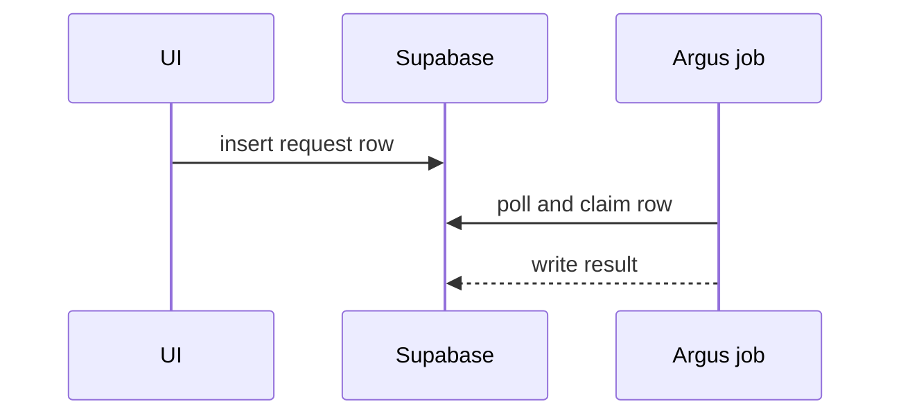

# PR body

Use this template. Skip preambles and keep prose short. Use the repository's `GLOSSARY.md` terms when it has one.

```markdown
## Summary

<one or two sentences, then the smallest view that makes the change clear>

## Evidence

- **Before:** <screenshot, output, or failing run>
- **After:** <screenshot, output, or passing run>

## Merge danger

**Door:** <one-way or two-way>

**Blast radius:** <what this can break, and every app or job that redeploys on merge>
```

End the body with the attribution line your instructions give, if any.

## Summary

Pick the smallest view that makes the point clear. Use two only when one cannot. Place each view next to the sentence it supports. Show only the calls, files, props, states, and boundaries a reviewer needs.

- Logic or an algorithm as pseudocode:

```text
on(save)
  if content is unchanged
    return cached result
  write new content
  return fresh result
```

- Runtime control flow as a call tree:

```text
submitForm
  createSession
    persistPrompt
    launchAgent
  navigateToSession
```

- UI structure as a component tree, with the state and module boundaries that matter:

```text
<SessionPage> (apps/example/src/routes/session.tsx)
  useSessionEvents()
  <SessionToolbar>
    <RunSkillButton> (packages/ui)
```

- File ownership or a broad refactor as a shallow file tree:

```text
src/
├── commands/       # parses user actions
├── sessions/       # owns session state
└── transport/      # sends API requests
```

- Data moving between parts, such as the app, Supabase, and an Argus job, as a Mermaid sequence diagram:



- A `diff` sketch when the point is what changes in a shape that already exists. Match the sketch to the topic: a call tree, a component tree, a file tree, or a control flow.

```diff
 on(save)
-  write content
+  if content is unchanged
+    return cached result
+  write new content
+  invalidate cache
```

- The whole block when most of it is new, when cut context would hide ownership or order, or when the reviewer needs a copyable target shape.

## Evidence

Show a before and an after from the real app or job.

- Best: screenshots, for a visual change.
- Next: output from an end-to-end run, a script, or a SQL query on staging. Name the exact command you ran.
- For a fixed bug, show the run that failed before the fix and passes after it.

If you could not run something, say what and why.

## Merge danger

- **Two-way door:** a revert undoes it. Most code changes are two-way.
- **One-way door:** a revert does not undo it. Examples are a production migration, deleted data, a renamed env var or route, and a sent message.

For the blast radius, name what can break: layout shifts, broken callers, mobile layouts, jobs that read a changed table. Then list every app or job that redeploys on merge.

In the apps monorepo, ask the Vercel ignore script which apps the branch rebuilds. Each app it prints redeploys on merge:

```bash
files=$(git diff --name-only origin/main...HEAD)
for f in apps/*/vercel.json; do
  app=$(grep -o 'vercel-ignore-build.sh [^"]*' "$f" | cut -d' ' -f2)
  [ -n "$app" ] && { VERCEL_IGNORE_FILES="$files" bash tools/vercel-ignore-build.sh "$app" >/dev/null 2>&1 || echo "$app"; }
done
```

In `twd-argus-engine`, a merge to main deploys the changed jobs through the WebNX runner. Name those jobs.
